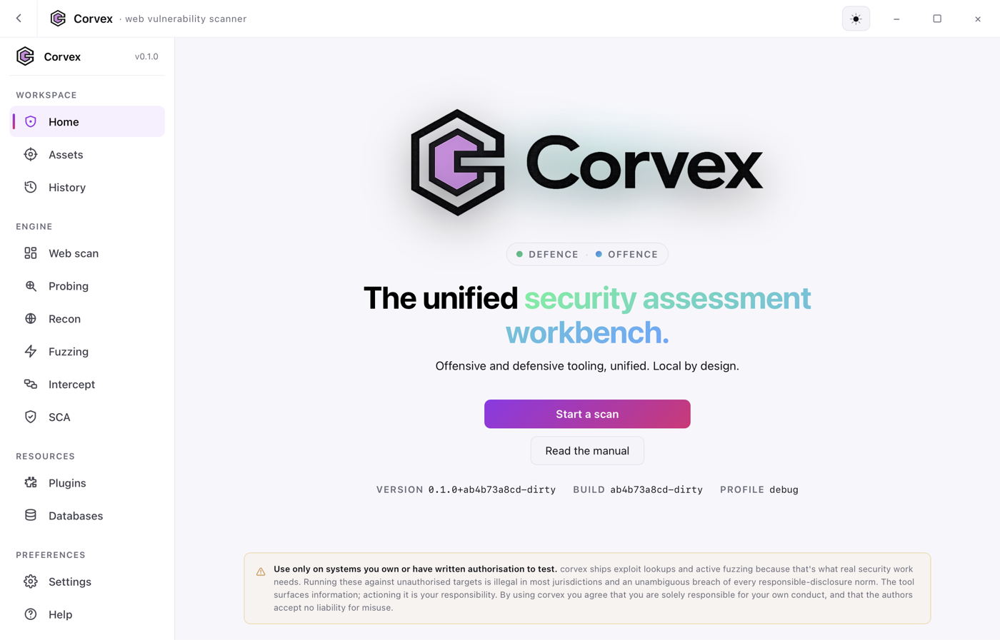
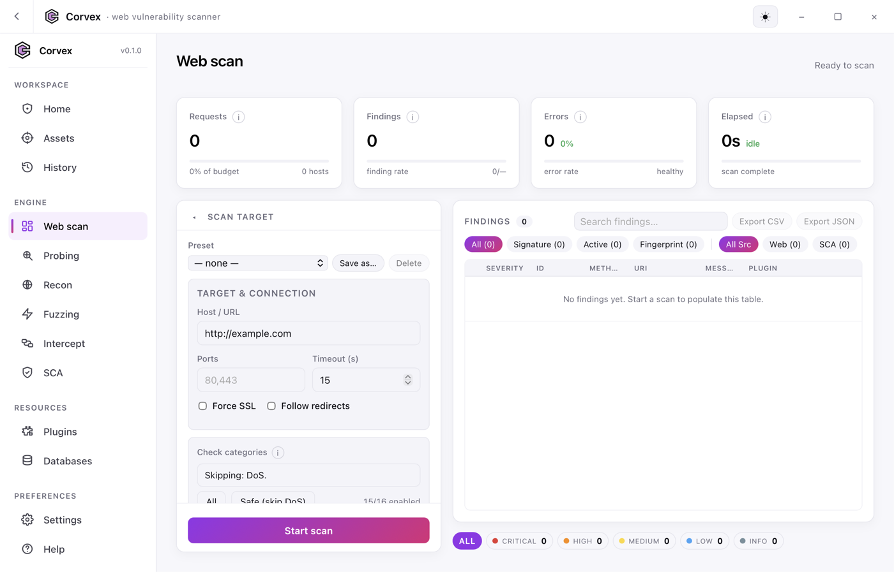
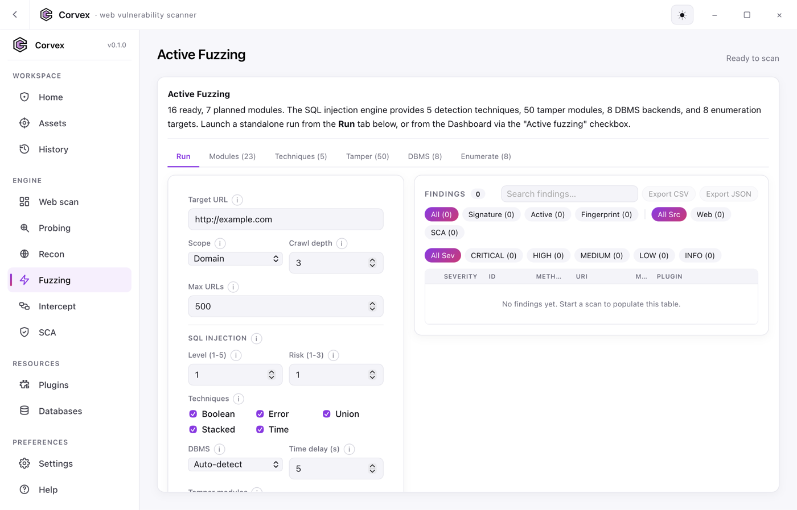
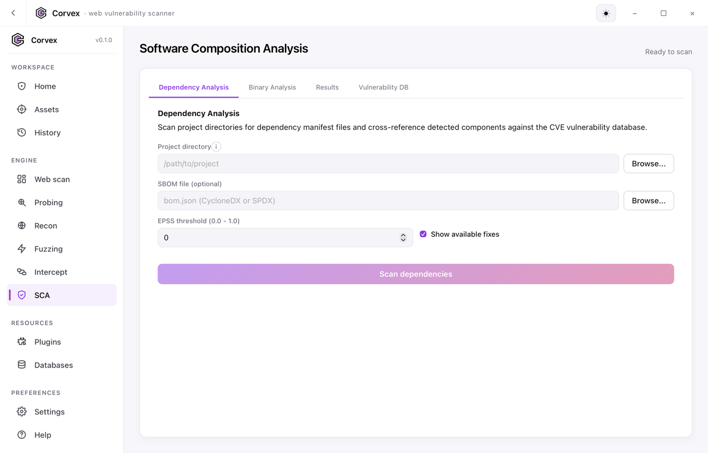
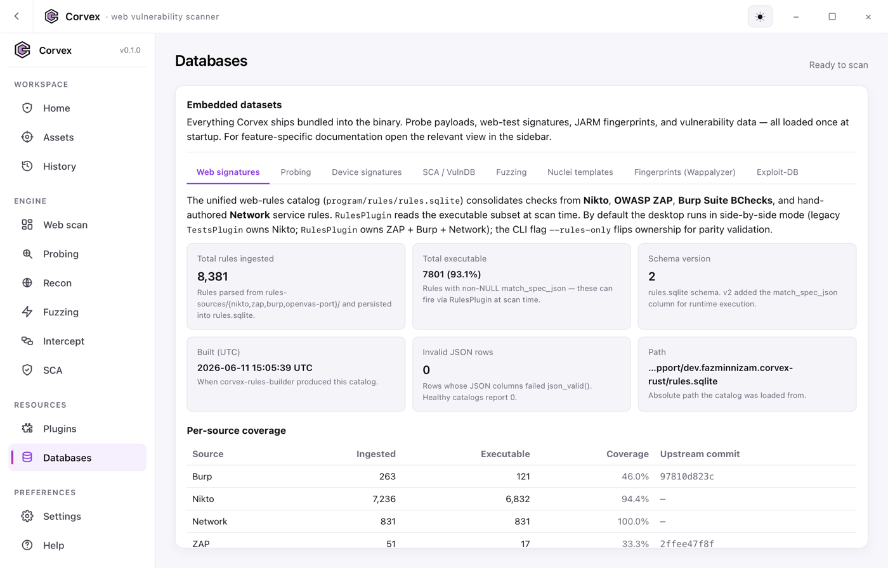

# Corvex

Corvex is a Rust web vulnerability scanner with four engines: a **signature engine** that probes targets against a 7,236-test database, an **active fuzzing engine** that crawls the target, extracts forms and parameters, and injects payloads to detect injection vulnerabilities in real time, a **SQL injection engine** with five detection techniques, 8 DBMS backends, ~50 WAF-bypass tamper modules, and full exploitation capabilities, and a **Software Composition Analysis (SCA) engine** that cross-references dependency manifests, SBOMs, and compiled binaries against a local NVD + EPSS vulnerability database with ~50 binary checkers for common libraries. Built on `tokio` for concurrency and raw HTTP/1.x framing with direct OpenSSL handshakes, SNI support, TLS 1.3 ciphersuites, and ALPN negotiation.

## Screenshots

<p align="center">
  <br>
  <sub>The desktop app — a unified workbench for web scanning, active fuzzing, SCA, and recon.</sub>
</p>

<table>
  <tr>
    <td width="50%"><br><sub><b>Web scan</b> — signature + active engine dashboard with live findings and stat cards.</sub></td>
    <td width="50%"><br><sub><b>Active fuzzing</b> — crawler, SQL injection level/risk/technique config, 50 tamper modules.</sub></td>
  </tr>
  <tr>
    <td width="50%"><br><sub><b>SCA</b> — dependency, SBOM, and binary analysis against the local CVE + EPSS database.</sub></td>
    <td width="50%"><br><sub><b>Databases</b> — stats for the embedded signature, probe, and vulnerability catalogs.</sub></td>
  </tr>
</table>

## What it does

### Signature engine (passive)

- Probes a target with Corvex's full signature database (7,236 tests + 1,257 outdated-software fingerprints + 362 favicon hashes + 260 server-banner rules + 170 auth realms + 40 404-page signatures + 1,825 dictionary entries).
- Expands `@LFI(nix|win|abs|url)` for local-file-inclusion tests, plus `@JUNK(n)`, `@IP`, `@HOSTNAME`, and every variable from `db_variables` (`@CGIDIRS`, `@USERS`, `@ADMIN`, ...).
- Runs 26 scan plugins: shellshock (CVE-2014-6271), Spring Boot actuator enumeration, Optionsbleed (CVE-2017-9798), MS10-070 ASP.NET padding oracle, PUT/DELETE verification, mod_userdir enumeration, mod_negotiation detection, exposed site files (`.git/`, `.env`, `backup.*`, `WEB-INF/`, ...), CGI directory probing, favicon fingerprinting, robots.txt harvesting, HTML path extraction, cookie leak analysis, HTTP auth realm matching with default-credential lookup, the full `db_tests` runner, and the active SQL injection scanner.
- Extracts TLS certificate subject, issuer, SAN, cipher, and protocol on the initial HTTPS handshake and surfaces them as findings.

### Active fuzzing engine

- **HTML crawler** with BFS link following, respecting scope (domain / subdomains / folder / page), configurable depth (`--crawl-depth`) and URL cap (`--max-urls`). Skips non-HTML responses and soft-404 pages. Live crawl progress tracked via `urls_crawled` counter visible in both the CLI output and the desktop app's stat cards.
- **Form extractor** parses every `<form>` on discovered pages, collecting method, action, and all input/select/textarea fields with their types and default values.
- **Injection-point framework** turns crawled URLs + forms into `FuzzTarget`s with typed `InjectionPoint`s (query param, POST body field, header, cookie, path segment). The `FuzzRunner` iterates one-parameter-at-a-time, sending mutated requests through the same `nfetch` pipeline so cookies, auth, evasion, and cancellation all work uniformly.
- Active fuzzing is **opt-in** via `--active` or `-Tuning g`. The default `@@DEFAULT` profile stays signature-only so existing workflows are unaffected.

### SQL injection engine

The SQL injection engine activates as part of the active fuzzing phase and provides deep injection testing comparable to dedicated SQL injection tools.

#### Detection techniques (5)

| Technique | How it works |
| --- | --- |
| **Error-based** | Injects boundary probes (`'`, `"`, `\`, `)`, ...`) and scans responses for 48 DBMS error patterns. At level >= 2, extracts data via `EXTRACTVALUE`, `UPDATEXML`, `CAST`, `CONVERT`. Fastest technique — typically 1-3 requests per parameter. |
| **Boolean-based blind** | Injects true/false SQL conditions (`AND 1=1` vs `AND 1=2`) and compares responses using trigram page-ratio analysis. Double-confirms with a secondary boolean pair to reduce false positives. ~3-6 requests per parameter. |
| **Time-based blind** | Injects `SLEEP()`, `WAITFOR DELAY`, `pg_sleep()`, `DBMS_PIPE.RECEIVE_MESSAGE` payloads and measures response time against a baseline median (3 samples). Confirms with a doubled delay. Request timeout auto-extended. |
| **UNION query-based** | Detects column count via `ORDER BY` binary search (up to 50 columns), finds visible columns via marker injection, then extracts `version()`, `database()`, `current_user()` through the visible column. Most powerful for direct data extraction. |
| **Stacked queries** | Tests semicolon-separated statement support via time-based confirmation. Primarily effective against MSSQL and PostgreSQL. Enables INSERT/UPDATE and OS command execution. Requires risk >= 2. |

Techniques run in priority order (Error -> Boolean -> Time -> UNION -> Stacked) and short-circuit when a parameter is confirmed at high confidence.

#### DBMS support (8)

MySQL, PostgreSQL, Microsoft SQL Server, Oracle, SQLite, MariaDB, IBM DB2, and Firebird. Each backend has tailored:
- Error message fingerprinting patterns (48 regex patterns total)
- Sleep/delay function syntax
- String concatenation and quoting syntax
- `information_schema` / catalog query equivalents
- File I/O and OS command execution vectors
- UNION FROM clause requirements (Oracle: `DUAL`, DB2: `SYSIBM.SYSDUMMY1`, Firebird: `RDB$DATABASE`)

Auto-detection via error fingerprinting, or force a specific backend with `--sqli-dbms`.

#### Tamper modules (~50)

WAF/IDS bypass transforms applied to SQL payloads before injection. Organized in five categories:

| Category | Modules | Examples |
| --- | --- | --- |
| Space replacement | 8 | `space2comment`, `space2hash`, `space2dash`, `space2plus`, `space2randomblank` |
| Encoding | 10 | `charencode`, `chardoubleencode`, `charunicodeencode`, `base64encode`, `overlongutf8`, `unmagicquotes` |
| Keyword obfuscation | 12 | `randomcase`, `randomcomments`, `versionedkeywords`, `commalesslimit`, `commentbeforeparentheses` |
| Comparison/logic | 8 | `between`, `greatest`, `equaltolike`, `symboliclogical`, `bluecoat`, `modsecurityversioned` |
| Injection/advanced | 12 | `apostrophemask`, `nonrecursivereplacement`, `sp_password`, `sleep2getlock`, `dunion` |

Chain multiple modules: `--tamper space2comment,randomcase,between`.

#### Enumeration

Post-detection extraction using whichever technique confirmed the vulnerability:

- **Databases** — `information_schema.schemata`, `pg_database`, `master..sysdatabases`, `all_tables`, `sqlite_master`, `syscat.schemata`, `RDB$RELATIONS`
- **Tables** — per-database table listing via DBMS-specific catalog queries
- **Columns** — per-table column enumeration
- **Users** — database user accounts
- **Password hashes** — `mysql.user`, `pg_shadow`, `sys.sql_logins`, `dba_users`
- **Privileges** — user privilege enumeration

For boolean-blind and time-blind, uses character-by-character binary search (ASCII bisection, ~8 requests per character). For UNION-based, direct data substitution in the visible column.

#### Exploitation

Requires `--sqli-risk 3`:

| Capability | DBMS | Vector |
| --- | --- | --- |
| **File read** | MySQL | `LOAD_FILE()` |
| | PostgreSQL | `pg_read_file()` |
| | MSSQL | `OPENROWSET(BULK)` |
| | Oracle | `UTL_FILE.GET_RAW()` |
| **File write** | MySQL | `INTO OUTFILE` |
| | PostgreSQL | `COPY TO` |
| | MSSQL | `xp_cmdshell echo` |
| **OS command** | MSSQL | `xp_cmdshell` |
| | PostgreSQL | `COPY TO PROGRAM` |
| | MySQL | UDF `sys_exec()` |
| | Oracle | `DBMS_SCHEDULER` |

#### OAST integration

When `--oast` is set, injects DNS callback payloads for out-of-band blind confirmation:
- MySQL: `LOAD_FILE('\\\\token.host\\a')`
- MSSQL: `xp_dirtree '\\\\token.host\\a'`
- PostgreSQL: `COPY TO PROGRAM 'nslookup token.host'`
- Oracle: `UTL_HTTP.REQUEST('http://token.host/')`

### Software Composition Analysis (SCA) engine

The SCA engine cross-references software components against a local CVE vulnerability database. It works independently of web scanning — point it at a project directory, an SBOM file, or a compiled binary, and it reports every known CVE affecting the detected components.

#### Vulnerability database

- **Local SQLite-backed CVE database** populated from NVD API v2.0 + OSV + EPSS (Exploit Prediction Scoring System).
- **Compile-time embedded snapshot**: a pre-built gzip-compressed SQLite snapshot ships inside the binary via `include_bytes!`. On first run, Corvex extracts it to `~/.corvex/vulndb.sqlite` — zero downloads needed out of the box.
- **Incremental updates**: the "Update database" button (or `corvex --vulndb-update latest`) fetches only CVEs modified since the snapshot's timestamp, typically <1 minute instead of a 5-30 minute full download.
- **Offline mode**: once the snapshot is extracted, no network access is required.
- **Retry logic**: NVD requests retry up to 5 times with exponential backoff (10s → 80s), with special handling for rate limits (HTTP 403/429) and server errors.
- **Rate limiting**: 10 req/min without API key, 100 req/min with `NVD_API_KEY`.
- **CPE 2.3 matching** with semantic version range comparison (`>=`, `>`, `<=`, `<` bounds) for precise vulnerability assignment.
- **EPSS integration** — every finding includes exploit probability (0.0-1.0) and percentile rank (0-100). Filter results with `--epss-threshold 0.5` or `--epss-percentile 90`.

#### Dependency parsers (7 ecosystems)

Walk a project directory and auto-detect any of:

| Ecosystem | Files |
| --- | --- |
| **Rust** | `Cargo.lock` |
| **JavaScript / Node** | `package-lock.json` (v1/v2/v3), `yarn.lock` |
| **Python** | `requirements.txt`, `Pipfile.lock` |
| **Java** | `pom.xml` |
| **Go** | `go.mod`, `go.sum` |
| **Ruby** | `Gemfile.lock` |
| **PHP** | `composer.lock` |

Each parser extracts component name, version, license (where available), and generates a Package URL (`pkg:npm/express@4.18.2`). A built-in CPE mapping table covers ~200 popular packages across all ecosystems; unknown packages fall back to best-guess CPE construction.

#### SBOM support

Parse and generate **Software Bill of Materials** in standard formats:

| Format | Parse | Generate |
| --- | :---: | :---: |
| CycloneDX JSON | ✓ | ✓ |
| CycloneDX XML | ✓ | ✓ |
| SPDX 2.3 JSON | ✓ | ✓ |
| SPDX 2.3 Tag-Value | ✓ | ✓ |

Use `--sbom-input bom.json` to scan components from an existing SBOM, or `--sbom-output report.json --sbom-format cyclonedx-json` to generate one from detected components.

#### Binary analysis engine

Scan compiled binaries for known vulnerable library versions. ~50 built-in checkers cover common C/C++ libraries and system tools:

- **Crypto/TLS**: OpenSSL, LibreSSL, GnuTLS, libssh, libssh2
- **HTTP/networking**: curl, wget, nginx, Apache httpd, lighttpd
- **Compression**: zlib, bzip2, xz/liblzma, libzip, zstd
- **XML/parsing**: libxml2, libxslt, expat
- **Image**: libpng, libjpeg, libtiff, libwebp, ImageMagick, FFmpeg
- **Database**: SQLite, PostgreSQL, MySQL, Redis
- **Runtimes**: Python, Node.js, PHP, Ruby, Perl, Go, Java/OpenJDK
- **System**: glibc, musl, libpcre, libpcre2
- **Tools**: OpenSSH, BIND, Samba, OpenLDAP, Postfix, Git, Bash, Vim, Sudo, systemd, dnsmasq, HAProxy

Each checker uses pattern-based string matching (like the Unix `strings` command) combined with regex version capture. Archive formats (ZIP, JAR, WAR, TAR, TAR.GZ) are automatically extracted and scanned recursively.

#### VEX + triage (optional)

Track per-CVE triage decisions in a local SQLite database (`~/.corvex/triage.sqlite`) with six states: `NewFound`, `Unexplored`, `Confirmed`, `Mitigated`, `FalsePositive`, `NotAffected`. Import triage data from CycloneDX VEX or OpenVEX documents with `--vex-input`; generate VEX output with `--vex-output --vex-format cyclonedx|openvex`. `FalsePositive` and `NotAffected` entries are suppressed from scan output.

#### Fix tracking

Each finding includes the available fix version (from NVD configurations and OSV advisories) so you know what to upgrade to. Enable with `--show-fixes`.

### Shared infrastructure

- Supports Basic, Digest (RFC 2617, qop=auth), and NTLM Type-1 HTTP authentication.
- TLS with SNI (Server Name Indication), TLS 1.3 ciphersuites, and ALPN `http/1.1` negotiation for compatibility with modern CDN/WAF-fronted servers.
- Loads user-supplied test databases at runtime via `-Userdbs`.
- Emits scan results as text, CSV, JSON, XML, HTML (using placeholder templates), SQL, or Markdown.
- **Report merging and diffing**: save scans with tags (`--save-report v1`), merge multiple saved scans (`--merge-reports v1,v2,v3`), and diff between scans (`--diff-reports baseline,latest`) to track vulnerability changes over time.
- **Config files**: load scan settings from `corvex.toml` or `corvex.yaml` (alongside the legacy `corvex.conf` key=value format). Generate templates with `--generate-config toml|yaml`.
- Structured error reporting: DNS failures, TLS handshake errors, HTTP timeouts, and connection resets are logged with full context so users can diagnose connectivity issues from the log panel.
- **Tauri v2 desktop app** with a React + TypeScript frontend, live findings streaming, 5-column stat dashboard (requests, findings, errors, elapsed, URLs crawled) with real-time crawler progress tracking, collapsible sidebar, light/dark/system theme, globally-responsive font scaling (12/14/16/19px), scan history persisted in SQLite, 5-tab fuzzing reference panel (modules, techniques, tamper, DBMS, enumerate), and integrated SQL injection configuration.

## Quick start

```bash
git clone https://github.com/fazminnizam/corvex
cd corvex
cargo build --release

# Signature-only scan (default)
./target/release/corvex --host http://www.example.com

# Active scan with crawler + injection fuzzers
./target/release/corvex --host http://www.example.com --active --scope domain

# Active scan with SQL injection testing
./target/release/corvex --host http://www.example.com --active --scope domain \
  --sqli-level 3 --sqli-risk 2 --sqli-techniques BEUST

# SCA scan of a project directory (no web target needed)
./target/release/corvex --host sca://local --scan-dir /path/to/project

# Binary analysis of a compiled executable or shared library
./target/release/corvex --host sca://local --binary-scan /usr/bin/ --binary-recursive
```

Prebuilt OpenSSL is not required — the workspace enables the `vendored` feature and builds OpenSSL from source. On Windows, this needs **Strawberry Perl** (not MSYS2 perl) and NASM on `PATH`; on Linux/macOS, a C toolchain is enough. When building from Git Bash on Windows, ensure Strawberry Perl is found first: `PATH="/c/Strawberry/perl/bin:$PATH" cargo build`.

## Desktop app

```bash
cargo install tauri-cli --version '^2'
cd crates/corvex-desktop/ui && npm install && cd ../../..
cargo tauri dev --manifest-path crates/corvex-desktop/Cargo.toml
```

Features:
- Frameless window with custom titlebar and window controls
- Collapsible sidebar with SVG icons (224px expanded / 64px collapsed)
- **5-column stat dashboard** (Requests, Findings, Errors, Elapsed, URLs Crawled) — the crawl card shows real-time progress against the user's `--max-urls` cap and `--crawl-depth` setting
- Live findings table with expandable detail rows, 4-way filter (All / Signature / Active / Fingerprint)
- Tracing log panel with structured error messages (DNS, TLS, HTTP errors surfaced with context)
- Scan history persisted in SQLite with CRUD operations
- **5-tab fuzzing reference panel**: Modules (22 fuzzers), Techniques (5 detection methods with how-it-works detail), Tamper (50 WAF-bypass modules), DBMS (8 backends with error patterns / sleep functions / catalogs), Enumerate (8 extraction targets with DBMS-specific queries)
- **SQL injection configuration panel** in the scan form: level (1-5), risk (1-3), technique checkboxes (B/E/U/S/T), DBMS dropdown, time delay, tamper modules, enumerate checkboxes — all with detailed info tooltips
- **Dedicated SCA view** in the sidebar with 4 tabs:
  - *Dependency Analysis* — scan a project directory for manifest files or parse an SBOM, with EPSS threshold filter and "show fixes" toggle
  - *Binary Analysis* — scan a file or directory with recursive + archive extraction options
  - *Results* — findings table with severity badges, clickable CVE links, component/version, EPSS scores, and fix version badges. Expandable detail rows show the full vulnerability summary.
  - *Vulnerability DB* — database statistics (CVE count, CPE matches, EPSS scores, fix records, last update timestamps) and an "Update database" button that fetches incremental changes
- Settings page with theme (light / dark / system) and **globally-responsive font scaling** (Small 12px / Medium 14px / Large 16px / Extra large 19px) — all text, tooltips, code elements, sidebar, stat cards, tables, and form labels scale immediately
- Light and dark themes with 30+ CSS custom properties

## Crate layout

Five-crate Cargo workspace:

- [crates/corvex-core](crates/corvex-core) — engine library: config (TOML / YAML / key=value), CLI, HTTP client (SNI + TLS 1.3 + ALPN), DSL parser + evaluator, variable expansion, crawler (with live `urls_crawled` counter), form extractor, fuzzer framework, scope filter, scan loop, plugin trait, report trait, target resolution, tuning / mutate / evasion, the SQL injection engine (DBMS fingerprinting, 5 detection techniques, payload generation, ~50 tamper modules, enumeration, exploitation), the **SCA engine** (dependency parsers for 7 ecosystems, CycloneDX + SPDX SBOM parse/generate, CPE mapping, CVE lookup with EPSS), the **binary analysis engine** (~50 library checkers, string extraction, archive handling), the **vulndb module** (SQLite-backed CVE database with NVD + OSV + EPSS clients, incremental update orchestrator, JSON export/import, and embedded-snapshot seeding), the **VEX + triage module** (CycloneDX VEX / OpenVEX parse+generate, SQLite-backed triage store), and the **report merging module**.
- [crates/corvex-plugins](crates/corvex-plugins) — 27 scan plugins (including the SCA plugin) + 7 report sinks (text, CSV, JSON, XML, HTML, SQL, Markdown).
- [crates/corvex](crates/corvex) — the `corvex` CLI binary.
- [crates/corvex-desktop](crates/corvex-desktop) — Tauri v2 desktop GUI with React + TypeScript frontend and a dedicated SCA view.
- [crates/vulndb-builder](crates/vulndb-builder) — standalone tool that downloads NVD + EPSS data and produces the compressed SQLite snapshot embedded in the binary. Supports incremental rebuilds (only fetches CVEs modified since the last snapshot) and full rebuilds (`--full`).

The 14 signature database files under [program/databases](program/databases) are compiled at build time into a single `bincode` blob and embedded via `include_bytes!`. If [program/vulndb/snapshot.db.gz](program/vulndb/) is present, it is also embedded and extracted on first run — so Corvex works offline out-of-the-box. The binary is self-contained.

## CLI flags

### Signature engine

| Flag | Purpose |
| --- | --- |
| `-host`, `-url` | Target host or URL |
| `-port` | One or more ports, comma-separated |
| `-ssl`, `-nossl` | Force SSL on/off |
| `-Tuning` | Filter tests by category (see below) |
| `-Plugins` | Plugin selector (`@@ALL`, `@@DEFAULT`, `-robots`, ...) |
| `-Format` | Output format(s): `txt`, `csv`, `json`, `htm`, `xml`, `sql` |
| `-output` | Write the report to this file |
| `-evasion` | IDS evasion transforms `1`-`9`, `A` |
| `-Add-header` | Extra request header, repeatable |
| `-id` | HTTP auth `user:pass[:realm]` (Basic / Digest / NTLM) |
| `-Userdbs` | Merge an additional user test CSV |
| `-useproxy` | Proxy URL override |
| `-404string` / `-404code` | Custom 404 heuristic |
| `-vhost` | Virtual host header |
| `-useragent` | Custom User-Agent |
| `-timeout`, `-Pause`, `-maxtime` | Time limits |
| `--max-concurrent-requests` | In-flight request cap |
| `--max-concurrent-hosts` | Parallel host cap |
| `--dbcheck` | Print database row counts |
| `--list-plugins` | Print plugin registry |
| `--Version` | Print version |

### Active fuzzing engine

| Flag | Purpose |
| --- | --- |
| `--active` | Enable active fuzzing (implies `--crawl`) |
| `--crawl` | Enable the HTML crawler |
| `--crawl-depth N` | Max link-following depth (default 3) |
| `--max-urls N` | Hard cap on crawled URLs (default 500) |
| `--scope` | `domain`, `subdomains`, `folder`, or `page` |
| `--exclude-pattern` | Exclude URLs matching this regex (repeatable) |
| `--openapi FILE` | Seed the crawl from an OpenAPI / Swagger spec |
| `--form-login URL` | POST to this URL to obtain a session cookie |
| `--form-login-data KV` | Form login body pairs (repeatable) |
| `--cookie-jar FILE` | Import Chrome / Firefox SQLite cookie DB |
| `--resume ID` | Resume a suspended scan session |
| `--oast URL` | Out-of-band callback host for blind detection |

### SQL injection engine

| Flag | Purpose |
| --- | --- |
| `--sqli-level N` | Testing level 1-5. 1=GET/POST params, 2=+cookies, 3=+User-Agent/Referer, 4=+other headers, 5=all |
| `--sqli-risk N` | Risk level 1-3. 1=safe read-only, 2=+OR-based, 3=+UPDATE/INSERT/file-write/OS-cmd |
| `--sqli-techniques BEUST` | Techniques to test: B=boolean, E=error, U=union, S=stacked, T=time |
| `--sqli-dbms DBMS` | Force DBMS: `mysql`, `postgresql`, `mssql`, `oracle`, `sqlite`, `mariadb`, `db2`, `firebird` |
| `--sqli-time-delay N` | Seconds for time-based blind delay (default 5) |
| `--tamper MODULES` | Comma-separated tamper module names (50 available) |
| `--sqli-second-url URL` | Second-order injection: check results on this URL |
| `--sqli-prefix PREFIX` | Force injection prefix (e.g. `')` or `1 AND`) |
| `--sqli-suffix SUFFIX` | Force injection suffix (e.g. `-- -` or `#`) |
| `--sqli-enumerate WHAT` | Post-detection targets: `dbs`, `tables`, `columns`, `users`, `dump`, `passwords`, `file-read`, `file-write`, `os-cmd` |

### SCA engine

| Flag | Purpose |
| --- | --- |
| `--scan-dir PATH` | Scan a project directory for dependency manifests |
| `--sbom-input FILE` | Parse an SBOM file (CycloneDX or SPDX, JSON or XML, auto-detected) |
| `--sbom-output FILE` | Generate an SBOM from detected components |
| `--sbom-format FMT` | `cyclonedx-json` (default), `cyclonedx-xml`, `spdx-json`, `spdx-tv` |
| `--epss-threshold N` | Only show CVEs with EPSS probability >= N (0.0-1.0) |
| `--epss-percentile N` | Only show CVEs with EPSS percentile >= N (0-100) |
| `--show-fixes` | Include fix version info in output |

### Binary analysis

| Flag | Purpose |
| --- | --- |
| `--binary-scan PATH` | Scan a binary file or directory for vulnerable library components |
| `--binary-recursive` | Recurse into subdirectories |
| `--binary-extract` | Extract and scan archive files (ZIP, JAR, WAR, TAR, TAR.GZ) |

### Vulnerability database

| Flag | Purpose |
| --- | --- |
| `--vulndb-update MODE` | `now` (full refresh), `daily` (default, check staleness), `never` (skip), `latest` (incremental) |
| `--vulndb-path PATH` | Custom path for the SQLite vulnerability database |
| `--nvd-api-key KEY` | NVD API key (or set `NVD_API_KEY` env var); raises rate limit from 10 to 100 req/min |
| `--vulndb-export FILE` | Export the vulnerability database to JSON |
| `--vulndb-import FILE` | Import a JSON snapshot into the database |

### VEX + triage

| Flag | Purpose |
| --- | --- |
| `--vex-input FILE` | Import a VEX document (CycloneDX VEX or OpenVEX, auto-detected) |
| `--vex-output FILE` | Generate a VEX document from triage data |
| `--vex-format FMT` | `cyclonedx` (default) or `openvex` |
| `--triage-filter LIST` | Show only CVEs with these triage statuses (comma-separated) |
| `--triage-set CVE=STATUS` | Set triage status for a CVE (repeatable) |

### Report merging

| Flag | Purpose |
| --- | --- |
| `--save-report TAG` | Save the scan output as a tagged report in `~/.corvex/reports/` |
| `--merge-reports TAGS` | Merge and deduplicate multiple tagged reports (comma-separated) |
| `--diff-reports TAGS` | Show CVEs added/removed between two tagged scans |

### Config files

| Flag | Purpose |
| --- | --- |
| `-config FILE` | Load scan settings from a file (auto-detects `.toml`, `.yaml`, `.yml`, or `.conf`) |
| `--generate-config FMT` | Generate a template config file (`toml` or `yaml`) |

Run `corvex --Help` for the complete list.

## Examples

```bash
# Signature scan with software-ID tuning, JSON output
corvex --host http://example.com -Tuning b -Format json --output scan.json

# Active scan: crawl + fuzz with domain scope
corvex --host http://example.com --active --scope domain --crawl-depth 4

# Active scan with limited crawl (10 URLs max)
corvex --host http://example.com --active --scope domain --max-urls 10

# Active scan seeded from an OpenAPI spec
corvex --host http://api.example.com --active --openapi ./openapi.json

# SQL injection scan with error + boolean + time techniques
corvex --host http://example.com --active --scope domain \
  --sqli-level 2 --sqli-risk 1 --sqli-techniques EBT

# SQL injection with MySQL targeting and WAF bypass
corvex --host http://example.com --active --scope domain \
  --sqli-dbms mysql --tamper space2comment,randomcase,between

# Full SQL injection scan with enumeration
corvex --host http://example.com --active --scope domain \
  --sqli-level 3 --sqli-risk 2 --sqli-techniques BEUST \
  --sqli-enumerate dbs,tables,columns,users,passwords

# SQL injection with exploitation (risk 3 required)
corvex --host http://example.com --active --scope domain \
  --sqli-level 5 --sqli-risk 3 --sqli-techniques BEUST \
  --sqli-enumerate dbs,tables,dump,file-read,os-cmd

# SQL injection with second-order detection
corvex --host http://example.com --active --scope domain \
  --sqli-level 3 --sqli-risk 2 --sqli-second-url http://example.com/profile

# SQL injection with OAST for blind confirmation
corvex --host http://example.com --active --scope domain \
  --sqli-level 3 --sqli-risk 2 --oast callback.burpcollaborator.net

# Authenticated scan with form login
corvex --host http://example.com --active --scope folder \
  --form-login http://example.com/login \
  --form-login-data 'user=admin' --form-login-data 'pass=secret'

# Signature + active combined, HTML report
corvex --host http://example.com --active --scope domain -Tuning bg -Format htm --output report.html

# Import browser cookies for an authenticated scan
corvex --host http://internal.example.com --active --cookie-jar ~/cookies.sqlite

# --- Software Composition Analysis ---

# Scan a project directory for dependency vulnerabilities
corvex --host sca://local --scan-dir ./my-project --show-fixes

# Scan an SBOM file, output results as Markdown
corvex --host sca://local --sbom-input bom.json -Format md --output report.md

# Scan dependencies, only show high-exploit-probability CVEs
corvex --host sca://local --scan-dir ./my-project --epss-threshold 0.5

# Generate an SBOM from a project directory
corvex --host sca://local --scan-dir ./my-project \
  --sbom-output my-app.cdx.json --sbom-format cyclonedx-json

# Binary analysis: scan all executables in /usr/bin recursively
corvex --host sca://local --binary-scan /usr/bin --binary-recursive

# Binary analysis with archive extraction (scans contents of JAR/ZIP/TAR files)
corvex --host sca://local --binary-scan ./artifacts --binary-recursive --binary-extract

# Update the vulnerability database (fetch only changes since last update)
corvex --host sca://local --vulndb-update latest --nvd-api-key YOUR_KEY

# Combined: web scan + SCA + save report for diffing later
corvex --host http://example.com --scan-dir ./my-project \
  --active --scope domain --save-report baseline-2026-04-14

# Diff two saved scans to find newly-introduced vulnerabilities
corvex --diff-reports baseline-2026-04-14,latest

# Generate a template TOML config file
corvex --generate-config toml > corvex.toml
```

## DSL

Corvex's test database matches responses with a tiny DSL:

- `CODE:` / `!CODE:` — match or negate HTTP status codes (regex).
- `BODY:` / `!BODY:` — match or negate a regex against the response body.
- `HEADER:` / `!HEADER:` — match or negate `name:value` against response headers.
- `COOKIE:` / `!COOKIE:` — match or negate a stored cookie value.
- `@LFI()` — placeholder expanded at runtime into `(BODY:<nix-canary>|BODY:<win-canary>)`.
- `&&` joins matchers (logical AND). Regex alternation (`|`) and `(?i)` work inside each pattern.

## Tuning categories

| Code | Category |
| --- | --- |
| `0` | File Upload |
| `1` | Interesting File / Seen in logs |
| `2` | Misconfiguration / Default File |
| `3` | Information Disclosure |
| `4` | Injection (XSS / Script / HTML) |
| `5` | Remote File Retrieval — Inside Web Root |
| `6` | Denial of Service |
| `7` | Remote File Retrieval — Server Wide |
| `8` | Command Execution / Remote Shell |
| `9` | SQL Injection |
| `a` | Authentication Bypass |
| `b` | Software Identification |
| `c` | Remote Source Inclusion |
| `d` | WebService |
| `e` | Administrative Console |
| `g` | Active fuzzing (crawler + injection probes) |
| `x` | Invert (include everything except the rest) |

## Architecture

- **HTTP**: direct TCP via `tokio::net::TcpStream`, HTTP/1.x framed by hand. TLS via `openssl::ssl::SslConnector` with SNI hostname set via `ssl.set_hostname()`, TLS 1.3 ciphersuites via `set_ciphersuites()`, ALPN `http/1.1` negotiation, and `SECLEVEL=0` with `ALL:COMPLEMENTOFALL` ciphers for legacy fingerprinting. Response timing captured via `Instant` for time-based blind injection detection.
- **TLS metadata**: `SslInfo` captured from the live handshake (cipher, protocol, cert chain). Stored on the per-host `Mark` and surfaced by the `ssl` plugin.
- **Error reporting**: DNS resolution failures, TLS handshake errors, HTTP request failures, and timeouts are logged at `ERROR`/`DEBUG` level with full context (target, error message, URI). These surface in the desktop app's log panel so users can diagnose connectivity issues.
- **Plugins**: compile-time `Plugin` trait with six hook points (`Start`, `Recon`, `Scan`, `Prefetch`, `Postfetch`, `Active`). Ascending weight order per hook. 26 plugins registered.
- **Active engine**: the `Active` hook runs after `Scan`. The crawler produces a `CrawlGraph` of discovered pages + forms, incrementing `GlobalState::urls_crawled` for each page visited. Each active plugin receives the graph and drives a `FuzzRunner` that iterates injection points one parameter at a time.
- **SQL injection engine**: lives in `corvex-core/src/sqli/` with 8 submodules. DBMS fingerprinting via 48 error regex patterns across 8 backends. Five detection technique modules run in priority order with short-circuit on high-confidence findings. ~50 tamper modules for WAF bypass. Enumeration engine with boolean binary-search and UNION extraction. Exploitation module with file I/O and OS command execution (risk-gated).
- **SCA engine**: lives in `corvex-core/src/sca/` (component model, dependency parsers, CPE mapping, CycloneDX/SPDX parsers/generators, CVE lookup) and `corvex-core/src/vulndb/` (SQLite-backed CVE database with NVD + OSV + EPSS clients, CPE version-range matching, schema migrations, JSON import/export, incremental update orchestrator). The `sca_plugin` in `corvex-plugins` hooks into the standard `Start` phase so SCA findings flow through the same `ReportItem` / `ReportSink` pipeline as web findings. A pre-built gzip-compressed SQLite snapshot at `program/vulndb/snapshot.db.gz` is embedded at compile time via `include_bytes!` and extracted to `~/.corvex/vulndb.sqlite` on first run.
- **Binary analysis engine**: lives in `corvex-core/src/binary/` with a `BinaryChecker` trait, a registry of ~50 regex-based checkers, a printable-ASCII string extractor (matching the Unix `strings` command), version parsers, and archive extractors for ZIP / JAR / TAR / TAR.GZ via the `zip` and `tar` + `flate2` crates. Detected libraries are emitted as `Component` values and fed through the same `lookup_component()` pipeline as dependency parsers.
- **NVD client resilience**: requests use a shared `fetch_page()` helper that retries up to 5 times on transient failures (HTTP 403/429 rate limits, 5xx server errors, body read failures, JSON parse errors) with exponential backoff (10s → 20s → 40s → 80s). Parse errors log the first 200 chars of the response body so you can see exactly what the server returned.
- **VEX + triage**: lives in `corvex-core/src/vex/`. The triage database at `~/.corvex/triage.sqlite` stores per-CVE status with six states. Import from VEX documents, export to VEX documents. Suppression of `FalsePositive` / `NotAffected` entries is applied as a filter after CVE lookup but before report emission.
- **Report merging**: lives in `corvex-core/src/merge/`. Saved reports live at `~/.corvex/reports/{tag}-{unix_timestamp}.json`. Deduplication keys off `(corvex_id, uri)`. Diffs produce `added`, `removed`, `unchanged` sets.
- **Scope**: `ScopeFilter` constrains the crawler and active plugins to the target domain, subdomains, folder, or page. `--exclude-pattern` regex blocklists layer on top.
- **Form extraction**: `scraper`-based parser extracts `<form>` elements with all fields, producing `FormDescriptor`s that the fuzzer framework converts into `FuzzTarget`s with typed `InjectionPoint`s.
- **Authentication**: Basic, Digest (RFC 2617, qop=auth), NTLM Type-1. Form-based auth via `--form-login`.
- **Databases**: 14 signature CSV files compiled to bincode at build time. User DBs merged at runtime via `-Userdbs`. The NVD + EPSS SQLite snapshot (if present at build time) is embedded as gzip-compressed bytes and extracted on first run.
- **Concurrency**: `tokio` runtime. Multiple hosts in parallel; per-host semaphore for in-flight requests.
- **Reports**: `ReportSink` trait with text, CSV, JSON, XML, HTML (template-based), SQL, and Markdown implementations. The Markdown sink produces structured `.md` output with severity tables, per-CVE vulnerability details (component, CVSS, EPSS, fix version), and a summary section.
- **Config loader**: auto-detects `.toml` / `.yaml` / `.yml` / `.conf` by extension. TOML and YAML files are flattened into dotted-key-value pairs so the rest of the engine consumes them through the same `Config` struct as the legacy format. `--generate-config` emits commented templates covering every option.
- **Desktop**: Tauri v2 + React. `TauriEventSink` streams findings live. `ScanStats` polls `GlobalState` including `urls_crawled` for real-time crawler progress. SQLite history. Tracing log bridge. Globally-responsive font scaling via `--font-base` CSS variable (all text, tooltips, code, tables, sidebar, stat cards scale together). SQL injection configuration panel with level/risk/technique/DBMS/tamper/enumerate controls. 5-tab fuzzing reference panel with detailed technique/tamper/DBMS/enumerate documentation.

## Developing

```bash
cargo check --workspace
cargo build --workspace --release
cargo test --workspace     # 58 tests currently passing

./target/debug/corvex --dbcheck
./target/debug/corvex --list-plugins
./target/debug/corvex --Version
```

### Building the vulnerability database snapshot

Before a release build, use the `vulndb-builder` tool to produce the embedded CVE snapshot. It supports both full downloads and incremental updates:

```bash
# First run: full NVD + EPSS download (~5 min with API key, ~30 min without)
cargo run --package vulndb-builder --release

# Subsequent runs: incremental update (only CVEs modified since last snapshot)
cargo run --package vulndb-builder --release

# Force full rebuild
cargo run --package vulndb-builder --release -- --full

# With API key for higher rate limit
cargo run --package vulndb-builder --release -- --api-key YOUR_NVD_KEY
# or set env var:
NVD_API_KEY=... cargo run --package vulndb-builder --release
```

The output is written to `program/vulndb/snapshot.db.gz`. Rebuild `corvex` with `cargo build --release` to embed it. The embedded snapshot lets the binary work offline out-of-the-box; the desktop app's "Update database" button then fetches only incremental changes.

Environment:

- `RUST_LOG=corvex_core=debug,tests_plugin=info` for per-plugin tracing.
- `RUST_LOG=http=debug,scan=debug` to see HTTP errors and scan-level failures.
- `RUST_LOG=vulndb=debug` to trace NVD/EPSS downloads and retries.
- `NVD_API_KEY=...` for faster NVD downloads (100 req/min instead of 10).
- `OPENSSL_NO_VENDOR=1` to use system OpenSSL instead of the vendored build.

## Authorized use only

This tool is intended for use in environments where you have explicit permission to test. Running it against servers you do not own or operate without written authorization is illegal in most jurisdictions. You assume all responsibility for how you use it.

## Third-party data

The desktop binary embeds third-party fingerprint data for service
identification. See [THIRD_PARTY_LICENSES.md](THIRD_PARTY_LICENSES.md)
for the required copyright and license notices.

Deep-mode scans can also load additional probe files supplied by the user at
runtime via `--service-probes <path>` (CLI) or the Settings view in the
desktop app. Such files are not bundled.

## License

Copyright 2026 Fazmin Nizam.

Licensed under the Apache License, Version 2.0 (the "License"); you may not use this project except in compliance with the License. You may obtain a copy of the License at https://www.apache.org/licenses/LICENSE-2.0, or in [LICENSE](LICENSE).

Unless required by applicable law or agreed to in writing, software distributed under the License is distributed on an "AS IS" BASIS, WITHOUT WARRANTIES OR CONDITIONS OF ANY KIND, either express or implied. See the License for the specific language governing permissions and limitations under the License.

This license covers Corvex's own source code. Some bundled third-party data (vendored signature/rule sources, the Exploit-DB index, LibWhisker) ships under its original upstream license — see [THIRD_PARTY_LICENSES.md](THIRD_PARTY_LICENSES.md), [COPYING.LibWhisker](COPYING.LibWhisker), and [rules-sources/VENDOR.md](rules-sources/VENDOR.md) for the specifics.
